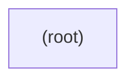

# orders-base — kết quả phân tích (bản sinh tự động)

- Snapshot: `snap:b4f357c449cb8f2890027f8e3037b30852aa06c14d4f6372ca58ed154c606616`
- Schema 0.1.0; renderer slice-render-v2; template slice-template-v1
- Phạm vi: 9 file trong 1 unit; 0 file bị loại khỏi snapshot

## Sơ đồ component

## Mục lục contract

- api: [tech-specs/ROOT/api/API-ORDERS-BASE-ROOT-v1.md](tech-specs/ROOT/api/API-ORDERS-BASE-ROOT-v1.md) — component `cmp_9bc109dffd090e5b2cd9c9173775fbcdc50dd15cb7fff3be472c7b9a0ae6644a`
- table: [tech-specs/ROOT/schema/TBL-ORDERS-BASE-ROOT.md](tech-specs/ROOT/schema/TBL-ORDERS-BASE-ROOT.md) — component `cmp_9bc109dffd090e5b2cd9c9173775fbcdc50dd15cb7fff3be472c7b9a0ae6644a`

## Mục lục EVT theo topic

- (không có)

## Contract chưa gán được component

- (không có)

## Giới hạn

- `SLICE_SCOPE` (inventory): Lát cắt đầu chỉ nhận route FastAPI và bảng SQLAlchemy Column
- `MODEL_NOT_RUN` (model): Không gọi provider; tên component lấy từ membership

## Giới hạn biểu diễn

- `DDL_BLOCK_OMITTED`: Không bảng nào đủ dữ kiện cho DDL — `fact:8ca5a859c53265448e0c088facbc6a4dbc57a5dd383f8a6bf7101cc78206208e`
- `DDL_TABLE_OMITTED`: dialect chưa biết — `fact:8ca5a859c53265448e0c088facbc6a4dbc57a5dd383f8a6bf7101cc78206208e`
- `OPENAPI_BLOCK_OMITTED`: Không route nào đủ method, path đầy đủ và status code — `fact:4e8707c75a42409cd9f2eb1abda314649c40656fbb47046c737261d755526f81`
- `OPENAPI_OPERATION_OMITTED`: Status code chưa biết — `fact:4e8707c75a42409cd9f2eb1abda314649c40656fbb47046c737261d755526f81`
