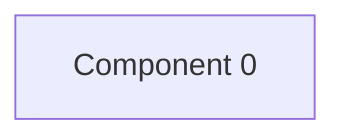

# Review shop — kết quả phân tích (bản sinh tự động)

- Snapshot: `snapshot-render-eval-v1`
- Schema 0.1.0; renderer slice-render-v2; template slice-template-v1
- Phạm vi: 1 file trong 1 unit; 0 file bị loại khỏi snapshot

## Sơ đồ component

## Mục lục contract

- api: [tech-specs/COMPONENT-0/api/API-REVIEW-SHOP-COMPONENT-0-v1.md](tech-specs/COMPONENT-0/api/API-REVIEW-SHOP-COMPONENT-0-v1.md) — component `cmp-000`

## Mục lục EVT theo topic

- (không có)

## Contract chưa gán được component

- (không có)

## Giới hạn

- (không có)

## Giới hạn biểu diễn

- `OPENAPI_BLOCK_OMITTED`: Không route nào đủ method, path đầy đủ và status code — `fact:3fc4ccfe745870e2c0d99f71f30ff0656c8dedd41cc1d7d3d376b0dbe685e2f3`, `fact:7692c3ad3540bb803c020b3aee66cd8887123234ea0c6e7143c0add73ff431ed`
- `OPENAPI_OPERATION_OMITTED`: Trùng method/path trong cùng file; không chọn handler — `fact:3fc4ccfe745870e2c0d99f71f30ff0656c8dedd41cc1d7d3d376b0dbe685e2f3`
- `OPENAPI_OPERATION_OMITTED`: Trùng method/path trong cùng file; không chọn handler — `fact:7692c3ad3540bb803c020b3aee66cd8887123234ea0c6e7143c0add73ff431ed`
