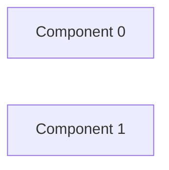

# Review shop — kết quả phân tích (bản sinh tự động)

- Snapshot: `snapshot-render-eval-v1`
- Schema 0.1.0; renderer slice-render-v2; template slice-template-v1
- Phạm vi: 2 file trong 1 unit; 0 file bị loại khỏi snapshot

## Sơ đồ component

## Mục lục contract

- event: [tech-specs/COMPONENT-0/events/EVT-REVIEW-SHOP-COMPONENT-0-ORDER-CREATED.md](tech-specs/COMPONENT-0/events/EVT-REVIEW-SHOP-COMPONENT-0-ORDER-CREATED.md) — component `cmp-000`
- event: [tech-specs/COMPONENT-1/events/EVT-REVIEW-SHOP-COMPONENT-1-ORDER-CREATED.md](tech-specs/COMPONENT-1/events/EVT-REVIEW-SHOP-COMPONENT-1-ORDER-CREATED.md) — component `cmp-001`

## Mục lục EVT theo topic

- order-created: [tech-specs/COMPONENT-0/events/EVT-REVIEW-SHOP-COMPONENT-0-ORDER-CREATED.md](tech-specs/COMPONENT-0/events/EVT-REVIEW-SHOP-COMPONENT-0-ORDER-CREATED.md) (publish); [tech-specs/COMPONENT-1/events/EVT-REVIEW-SHOP-COMPONENT-1-ORDER-CREATED.md](tech-specs/COMPONENT-1/events/EVT-REVIEW-SHOP-COMPONENT-1-ORDER-CREATED.md) (consume)

## Contract chưa gán được component

- (không có)

## Giới hạn

- (không có)

## Giới hạn biểu diễn

- (không có)
