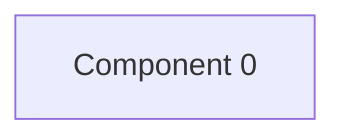

# Review shop — kết quả phân tích (bản sinh tự động)

- Snapshot: `snapshot-render-eval-v1`
- Schema 0.1.0; renderer slice-render-v2; template slice-template-v1
- Phạm vi: 1 file trong 1 unit; 0 file bị loại khỏi snapshot

## Sơ đồ component

## Mục lục contract

- event: [tech-specs/COMPONENT-0/events/EVT-REVIEW-SHOP-COMPONENT-0-UNKNOWN-8B5CC4DF7EEC.md](tech-specs/COMPONENT-0/events/EVT-REVIEW-SHOP-COMPONENT-0-UNKNOWN-8B5CC4DF7EEC.md) — component `cmp-000`
- event: [tech-specs/COMPONENT-0/events/EVT-REVIEW-SHOP-COMPONENT-0-UNKNOWN-AC0F09C0F8BF.md](tech-specs/COMPONENT-0/events/EVT-REVIEW-SHOP-COMPONENT-0-UNKNOWN-AC0F09C0F8BF.md) — component `cmp-000`

## Mục lục EVT theo topic

- (topic chưa biết): [tech-specs/COMPONENT-0/events/EVT-REVIEW-SHOP-COMPONENT-0-UNKNOWN-8B5CC4DF7EEC.md](tech-specs/COMPONENT-0/events/EVT-REVIEW-SHOP-COMPONENT-0-UNKNOWN-8B5CC4DF7EEC.md) (consume); [tech-specs/COMPONENT-0/events/EVT-REVIEW-SHOP-COMPONENT-0-UNKNOWN-AC0F09C0F8BF.md](tech-specs/COMPONENT-0/events/EVT-REVIEW-SHOP-COMPONENT-0-UNKNOWN-AC0F09C0F8BF.md) (consume)

## Contract chưa gán được component

- (không có)

## Giới hạn

- (không có)

## Giới hạn biểu diễn

- `EVENT_BINDING_UNRESOLVED`: Chưa chứng minh broker/namespace/serialization/topic; điểm này giữ riêng — `fact:8b5cc4df7eec7d32a7814eca4af047ae33b2d52342667715682e19c25b0b9faa`
- `EVENT_BINDING_UNRESOLVED`: Chưa chứng minh broker/namespace/serialization/topic; điểm này giữ riêng — `fact:ac0f09c0f8bf5e7a4b063d863255f16d8ce9abe600e288d934cf313bcbff63eb`
