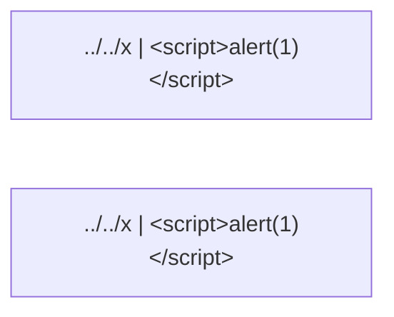

# Review shop — kết quả phân tích (bản sinh tự động)

- Snapshot: `snapshot-render-eval-v1`
- Schema 0.1.0; renderer slice-render-v2; template slice-template-v1
- Phạm vi: 2 file trong 1 unit; 0 file bị loại khỏi snapshot

## Sơ đồ component

## Mục lục contract

- api: [tech-specs/X-SCRIPT-ALERT-1-SCRIPT/api/API-REVIEW-SHOP-X-SCRIPT-ALERT-1-SCRIPT-v1.md](tech-specs/X-SCRIPT-ALERT-1-SCRIPT/api/API-REVIEW-SHOP-X-SCRIPT-ALERT-1-SCRIPT-v1.md) — component `cmp-000`

## Mục lục EVT theo topic

- (không có)

## Contract chưa gán được component

- (không có)

## Giới hạn

- (không có)

## Giới hạn biểu diễn

- (không có)
