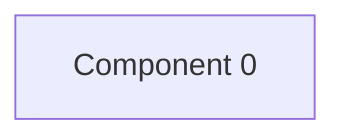

# Review shop — kết quả phân tích (bản sinh tự động)

- Snapshot: `snapshot-render-eval-v1`
- Schema 0.1.0; renderer slice-render-v2; template slice-template-v1
- Phạm vi: 1 file trong 1 unit; 0 file bị loại khỏi snapshot

## Sơ đồ component

## Mục lục contract

- table: [tech-specs/COMPONENT-0/schema/TBL-REVIEW-SHOP-COMPONENT-0.md](tech-specs/COMPONENT-0/schema/TBL-REVIEW-SHOP-COMPONENT-0.md) — component `cmp-000`

## Mục lục EVT theo topic

- (không có)

## Contract chưa gán được component

- (không có)

## Giới hạn

- (không có)

## Giới hạn biểu diễn

- `DDL_BLOCK_OMITTED`: Không bảng nào đủ dữ kiện cho DDL — `fact:0d4fc4a78d3706edccafb665a8b2fdd9309e82c78625bb0f2b8e7bb9e1c4d21c`
- `DDL_TABLE_OMITTED`: Tên cột hoặc kiểu ngoài catalogue — `fact:0d4fc4a78d3706edccafb665a8b2fdd9309e82c78625bb0f2b8e7bb9e1c4d21c`
