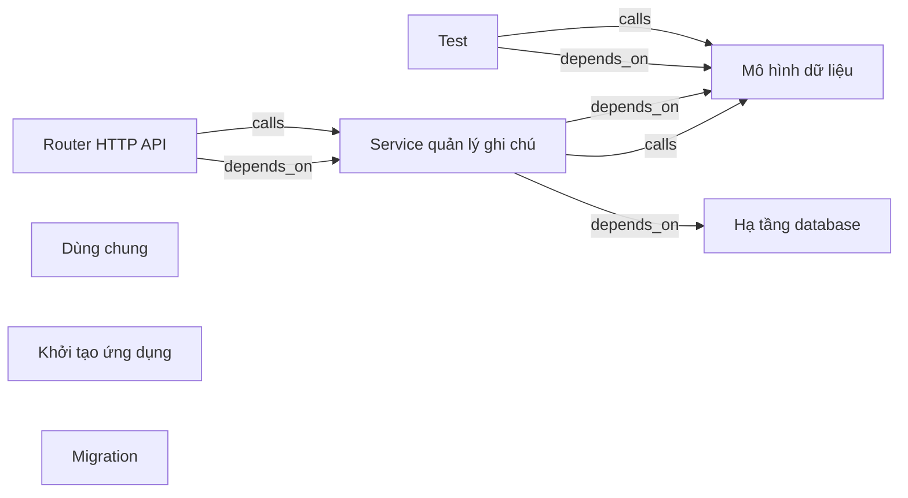

# rhoboro-demo — kết quả phân tích (bản sinh tự động)

- Snapshot: `snap:c1495361276c6c8cd263abcb7919dea2d99441c993412393b1b5bc40363054af`
- Schema 0.1.0; renderer slice-render-v2; template slice-template-v1
- Phạm vi: 32 file trong 1 unit; 14 file bị loại khỏi snapshot

## Sơ đồ component

## Mục lục contract

- api: [tech-specs/ROUTER-HTTP-API/api/API-RHOBORO-DEMO-ROUTER-HTTP-API-v1.md](tech-specs/ROUTER-HTTP-API/api/API-RHOBORO-DEMO-ROUTER-HTTP-API-v1.md) — component `cmp_4690cbbf2f7c9c5c974208becb0d401a8741afc469217e111e8f65ccc202159f`
- table: [tech-specs/MO-HINH-DU-LIEU/schema/TBL-RHOBORO-DEMO-MO-HINH-DU-LIEU.md](tech-specs/MO-HINH-DU-LIEU/schema/TBL-RHOBORO-DEMO-MO-HINH-DU-LIEU.md) — component `cmp_8d1ed1302bacaffe72a99e43a5398d83ad75ddf4b37c77feaf746c8597200e20`
- api: [tech-specs/KHOI-TAO-UNG-DUNG/api/API-RHOBORO-DEMO-KHOI-TAO-UNG-DUNG-v1.md](tech-specs/KHOI-TAO-UNG-DUNG/api/API-RHOBORO-DEMO-KHOI-TAO-UNG-DUNG-v1.md) — component `cmp_e0eec3530f42bf8364ab7755b22c499e6783365e9f44d06510d7e5a8998bbd68`

## Mục lục EVT theo topic

- (không có)

## Contract chưa gán được component

- (không có)

## Giới hạn

- `SLICE_SCOPE` (inventory): Lát cắt đầu chỉ nhận route FastAPI và bảng SQLAlchemy Column
- `REFERENCE_UNRESOLVED` (extraction): 47 lời gọi chưa nối được đích; giữ là dữ kiện unresolved kèm lý do, không vẽ thành cạnh
- `MODEL_NOT_RUN` (model): Không gọi provider; tên component lấy từ membership

## Giới hạn biểu diễn

- `DDL_BLOCK_OMITTED`: Không bảng nào đủ dữ kiện cho DDL — `fact:0dabd6cd1f0d8e83556760f03b20af7650bdafe44da4d77a865b33e6f9e07b36`, `fact:678a9e546bff3fa2b09ad37a23d4e86203f60f53a7343fea0a0b61055d93b4fb`
- `DDL_TABLE_OMITTED`: dialect chưa biết — `fact:0dabd6cd1f0d8e83556760f03b20af7650bdafe44da4d77a865b33e6f9e07b36`
- `DDL_TABLE_OMITTED`: dialect chưa biết — `fact:678a9e546bff3fa2b09ad37a23d4e86203f60f53a7343fea0a0b61055d93b4fb`
