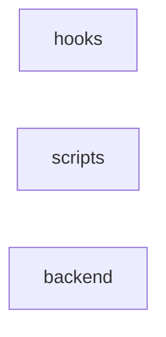

# repository — kết quả phân tích (bản sinh tự động)

- Snapshot: `snap:48597b2fdd287ad86cc29ce72b953974a5e80a8bd80724a4e7127483d7402ac9`
- Schema 0.1.0; renderer slice-render-v2; template slice-template-v1
- Phạm vi: 45 file trong 1 unit; 207 file bị loại khỏi snapshot

## Sơ đồ component

## Mục lục contract

- api: [tech-specs/BACKEND/api/API-REPOSITORY-BACKEND-v1.md](tech-specs/BACKEND/api/API-REPOSITORY-BACKEND-v1.md) — component `cmp_70c1479e9d6b0a5e15cea4bc883ef97f5314636df9e8ddb23c02d3250486a606`
- table: [tech-specs/BACKEND/schema/TBL-REPOSITORY-BACKEND.md](tech-specs/BACKEND/schema/TBL-REPOSITORY-BACKEND.md) — component `cmp_70c1479e9d6b0a5e15cea4bc883ef97f5314636df9e8ddb23c02d3250486a606`

## Mục lục EVT theo topic

- (không có)

## Contract chưa gán được component

- (không có)

## Giới hạn

- `SLICE_SCOPE` (inventory): Lát cắt đầu chỉ nhận route FastAPI và bảng SQLAlchemy Column
- `PARSE_FAILED` (extraction): backend/app/api/deps.py: SyntaxError
- `REFERENCE_UNRESOLVED` (extraction): 103 lời gọi chưa nối được đích; giữ là dữ kiện unresolved kèm lý do, không vẽ thành cạnh
- `MODEL_NOT_RUN` (model): Không gọi provider; tên component lấy từ membership
- `COMPONENT_WITHOUT_EVIDENCE` (verification): (root)

## Giới hạn biểu diễn

- `DDL_BLOCK_OMITTED`: Không bảng nào đủ dữ kiện cho DDL — `fact:bc55ebf0febfb292514d4a8da02096ec1d46d2fbc049f90747e81e9286e6d14f`, `fact:feca1457149e79086f4d45c6a15897d79c9a8713cbb6b42f3b0f022752df83cc`
- `DDL_TABLE_OMITTED`: dialect chưa biết — `fact:bc55ebf0febfb292514d4a8da02096ec1d46d2fbc049f90747e81e9286e6d14f`
- `DDL_TABLE_OMITTED`: dialect chưa biết — `fact:feca1457149e79086f4d45c6a15897d79c9a8713cbb6b42f3b0f022752df83cc`
