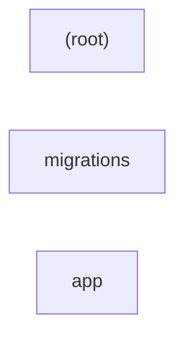

# repository — kết quả phân tích (bản sinh tự động)

- Snapshot: `snap:c1495361276c6c8cd263abcb7919dea2d99441c993412393b1b5bc40363054af`
- Schema 0.1.0; renderer slice-render-v2; template slice-template-v1
- Phạm vi: 32 file trong 1 unit; 13 file bị loại khỏi snapshot

## Sơ đồ component

## Mục lục contract

- api: [tech-specs/APP/api/API-REPOSITORY-APP-v1.md](tech-specs/APP/api/API-REPOSITORY-APP-v1.md) — component `cmp_feb33ad0dd6c5afcb686ceacb60106d85eaf3b0b9033c5cb172ef4e7fd3ad589`
- table: [tech-specs/APP/schema/TBL-REPOSITORY-APP.md](tech-specs/APP/schema/TBL-REPOSITORY-APP.md) — component `cmp_feb33ad0dd6c5afcb686ceacb60106d85eaf3b0b9033c5cb172ef4e7fd3ad589`

## Mục lục EVT theo topic

- (không có)

## Contract chưa gán được component

- (không có)

## Giới hạn

- `SLICE_SCOPE` (inventory): Lát cắt đầu chỉ nhận route FastAPI và bảng SQLAlchemy Column
- `MODEL_NOT_RUN` (model): Không gọi provider; tên component lấy từ membership

## Giới hạn biểu diễn

- `DDL_BLOCK_OMITTED`: Không bảng nào đủ dữ kiện cho DDL — `fact:0dabd6cd1f0d8e83556760f03b20af7650bdafe44da4d77a865b33e6f9e07b36`, `fact:678a9e546bff3fa2b09ad37a23d4e86203f60f53a7343fea0a0b61055d93b4fb`
- `DDL_TABLE_OMITTED`: dialect chưa biết — `fact:0dabd6cd1f0d8e83556760f03b20af7650bdafe44da4d77a865b33e6f9e07b36`
- `DDL_TABLE_OMITTED`: dialect chưa biết — `fact:678a9e546bff3fa2b09ad37a23d4e86203f60f53a7343fea0a0b61055d93b4fb`
- `OPENAPI_OPERATION_OMITTED`: Status code chưa biết — `fact:3fc5ada3636d9f3b05807fadc84c90f182a282392e8fcf71ba3813bf5e5aef69`
- `OPENAPI_OPERATION_OMITTED`: Status code chưa biết — `fact:48fc2b0417db8edb4f658adf19600c4385a377b2dbe23f96b8ba479b2102a05f`
- `OPENAPI_OPERATION_OMITTED`: Status code chưa biết — `fact:5bcb81a041f363ef509d8a701168aa608528fa33f373088b4d77413d1fc464a3`
- `OPENAPI_OPERATION_OMITTED`: Status code chưa biết — `fact:5f799764ef1f08ddba746aeb82cb7f8583033a196adfa8b46742fa23e984ec09`
- `OPENAPI_OPERATION_OMITTED`: Status code chưa biết — `fact:c6e03ebe31d0bd3ed117620c0d11eb8141c8244aa6da5855daabdb7c789d42e4`
- `OPENAPI_OPERATION_OMITTED`: Status code chưa biết — `fact:c6f5c3a4fc58017eeceed85d3fe44e07ed3af71b3af83e0fc89136413cc7196d`
- `OPENAPI_OPERATION_OMITTED`: Status code chưa biết — `fact:c85e7bbfbc5387fef3868da123d3023bb10305b2b0ab22fd62e6a7b7260b5666`
- `OPENAPI_OPERATION_OMITTED`: Status code chưa biết — `fact:d2babca031fecb5879078d3a63827826f17f096079984e25e291bca8fb1c90ca`
- `OPENAPI_OPERATION_OMITTED`: Status code chưa biết — `fact:e336eaa4b604df25f97224461a64aed6839279a00b99e5e850b928624439f826`
