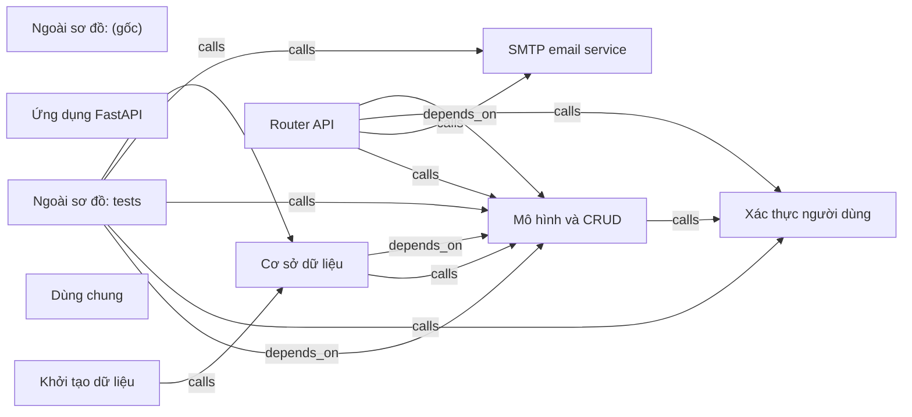

# backend — kết quả phân tích (bản sinh tự động)

- Snapshot: `snap:a355ffb266c01c96dcd657c3eb75dedec5209dbeee29d33388931890dbe286d2`
- Schema 0.1.0; renderer slice-render-v2; template slice-template-v1
- Phạm vi: 41 file trong 1 unit; 16 file bị loại khỏi snapshot

## Sơ đồ component

## Mục lục contract

- table: [tech-specs/MO-HINH-VA-CRUD/schema/TBL-BACKEND-MO-HINH-VA-CRUD.md](tech-specs/MO-HINH-VA-CRUD/schema/TBL-BACKEND-MO-HINH-VA-CRUD.md) — component `cmp_bfa777357f467acc5808425bed4db5f48df27a89c328fdf0d7552df7525a562a`
- api: [tech-specs/ROUTER-API/api/API-BACKEND-ROUTER-API-v1.md](tech-specs/ROUTER-API/api/API-BACKEND-ROUTER-API-v1.md) — component `cmp_e87edabf2e26bfbe0c7af8108ca770d32089de7dd2ce84ec055b2f0b8c841c0d`

## Mục lục EVT theo topic

- (không có)

## Contract chưa gán được component

- (không có)

## Giới hạn

- `SLICE_SCOPE` (inventory): Lát cắt đầu chỉ nhận route FastAPI và bảng SQLAlchemy Column
- `PARSE_FAILED` (extraction): app/api/deps.py: SyntaxError
- `RUNTIME_DEPENDENT_PREFIX` (extraction): Prefix phụ thuộc lúc chạy: {settings.API_V1_STR}
- `RUNTIME_DEPENDENT_PREFIX` (extraction): Prefix phụ thuộc lúc chạy: {settings.API_V1_STR}
- `RUNTIME_DEPENDENT_PREFIX` (extraction): Prefix phụ thuộc lúc chạy: {settings.API_V1_STR}
- `RUNTIME_DEPENDENT_PREFIX` (extraction): Prefix phụ thuộc lúc chạy: {settings.API_V1_STR}
- `RUNTIME_DEPENDENT_PREFIX` (extraction): Prefix phụ thuộc lúc chạy: {settings.API_V1_STR}
- `RUNTIME_DEPENDENT_PREFIX` (extraction): Prefix phụ thuộc lúc chạy: {settings.API_V1_STR}
- `RUNTIME_DEPENDENT_PREFIX` (extraction): Prefix phụ thuộc lúc chạy: {settings.API_V1_STR}
- `RUNTIME_DEPENDENT_PREFIX` (extraction): Prefix phụ thuộc lúc chạy: {settings.API_V1_STR}
- `RUNTIME_DEPENDENT_PREFIX` (extraction): Prefix phụ thuộc lúc chạy: {settings.API_V1_STR}
- `RUNTIME_DEPENDENT_PREFIX` (extraction): Prefix phụ thuộc lúc chạy: {settings.API_V1_STR}
- `RUNTIME_DEPENDENT_PREFIX` (extraction): Prefix phụ thuộc lúc chạy: {settings.API_V1_STR}
- `RUNTIME_DEPENDENT_PREFIX` (extraction): Prefix phụ thuộc lúc chạy: {settings.API_V1_STR}
- `RUNTIME_DEPENDENT_PREFIX` (extraction): Prefix phụ thuộc lúc chạy: {settings.API_V1_STR}
- `RUNTIME_DEPENDENT_PREFIX` (extraction): Prefix phụ thuộc lúc chạy: {settings.API_V1_STR}
- `RUNTIME_DEPENDENT_PREFIX` (extraction): Prefix phụ thuộc lúc chạy: {settings.API_V1_STR}
- `RUNTIME_DEPENDENT_PREFIX` (extraction): Prefix phụ thuộc lúc chạy: {settings.API_V1_STR}
- `RUNTIME_DEPENDENT_PREFIX` (extraction): Prefix phụ thuộc lúc chạy: {settings.API_V1_STR}
- `RUNTIME_DEPENDENT_PREFIX` (extraction): Prefix phụ thuộc lúc chạy: {settings.API_V1_STR}
- `RUNTIME_DEPENDENT_PREFIX` (extraction): Prefix phụ thuộc lúc chạy: {settings.API_V1_STR}
- `RUNTIME_DEPENDENT_PREFIX` (extraction): Prefix phụ thuộc lúc chạy: {settings.API_V1_STR}
- `RUNTIME_DEPENDENT_PREFIX` (extraction): Prefix phụ thuộc lúc chạy: {settings.API_V1_STR}
- `RUNTIME_DEPENDENT_PREFIX` (extraction): Prefix phụ thuộc lúc chạy: {settings.API_V1_STR}
- `RUNTIME_DEPENDENT_PREFIX` (extraction): Prefix phụ thuộc lúc chạy: {settings.API_V1_STR}
- `REFERENCE_UNRESOLVED` (extraction): 89 lời gọi chưa nối được đích; giữ là dữ kiện unresolved kèm lý do, không vẽ thành cạnh
- `MODEL_NOT_RUN` (model): Không gọi provider; tên component lấy từ membership

## Giới hạn biểu diễn

- `DDL_BLOCK_OMITTED`: Không bảng nào đủ dữ kiện cho DDL — `fact:1945b1f95a04b1d52cb98ac4db132597b4c29d885cd9460bc1fbce0cfb51a5a1`, `fact:7f9fa6430cf52f8eccfe9f48db055d45eb0e169149934ac352603e097a1563cb`
- `DDL_TABLE_OMITTED`: dialect chưa biết — `fact:1945b1f95a04b1d52cb98ac4db132597b4c29d885cd9460bc1fbce0cfb51a5a1`
- `DDL_TABLE_OMITTED`: dialect chưa biết — `fact:7f9fa6430cf52f8eccfe9f48db055d45eb0e169149934ac352603e097a1563cb`
- `OPENAPI_BLOCK_OMITTED`: Không route nào đủ method, path đầy đủ và status code — `fact:00f16e3041138f5b07ecad71fd0bfab97e984302282d7c5c918bda1fab373c23`, `fact:0e84214918a9a4341f3514d7e1b2de0dcb3677970f79f1e18a172e506139154a`, `fact:1d081e233b928b637b4db0908d9d142e413e72e578212a098ae29994109d533b`, `fact:20f807e43e0ae5a97c55741872fa1eace12dacb9c68d9ab09d36269e5ead04eb`, `fact:2a737c1d0778a866c99002b4c4b9c4cf5351c1e3e15bb622a939403c76417c5a`, `fact:3ca3ef04a61bd27827a73b6d7e1d5a4d89c36433ad523e8796f6f00efdea15e4`, `fact:3ca60784fbb519ddfe1433d21dc3db6bb5ee45bcb924755f104b8b00887d364e`, `fact:3f7919a6e73890d5736e5edaa96ebbc910491c47287782aa30b0a3033371a23f`, `fact:4afd2af610465bd9c3b5b460b2d35e3c191c8b908f8a7e99e1159c2bf3defdf9`, `fact:4e3cf9af59f1056b2e621986f76dd50f95456623491a1d9d0460d50cf43a9173`, `fact:6d2a30cc2d925c76966e8f5d52ac452f71044695d38a61ae25d86313d7203fc5`, `fact:6df2aefe959aa9bbcadb45f95989b81b4d714263e2a5f196af6ad57cfa41753b`, `fact:95e2ec8443655aa9ecaa5ecd7d36c945e8f6b60ae945066b261e01f8cd6eca07`, `fact:9bd38df6c1778c592e1b5feaabfec399b8a1f2c41ccf66648e91b3fdea64ed5f`, `fact:a644dff9b537c058ce6ab5f1b9189c3397cc8b8d9085922447cf46269b3b040a`, `fact:b15c97c83792734fdb1085a928b717725f7df0b627ee76783090de64fb9e6fa7`, `fact:cac60b0f62feeb011710e1d46a31234da7a7f676cf3f1cb184766791285b6b6d`, `fact:cde0f0d1b2afe79fb121cb31c86823b4612943adb10ff65a856440b675b10088`, `fact:cf346eb7516ced89edbf31c3bc6e19baac2d9c2d1279f9f1095b8f0d48c7d925`, `fact:ec3a1aa433b330e69d2aa89114739013e8d8c5bc8cd3f9a954f439964c6959e1`, `fact:f18173b8bc71dbf380a0410d78f198af43352fbb1a4cad8304abd7d17097cb88`, `fact:f20370e846683873af4ed6e1079424d118ba0bada222870d49adf60ec4d580cd`, `fact:fbf788ffd95bc913af38c9c17c2e9854d04b29a71bb9018f88034392a4ab2ae5`
- `OPENAPI_OPERATION_OMITTED`: Path đầy đủ chưa biết — `fact:00f16e3041138f5b07ecad71fd0bfab97e984302282d7c5c918bda1fab373c23`
- `OPENAPI_OPERATION_OMITTED`: Path đầy đủ chưa biết — `fact:0e84214918a9a4341f3514d7e1b2de0dcb3677970f79f1e18a172e506139154a`
- `OPENAPI_OPERATION_OMITTED`: Path đầy đủ chưa biết — `fact:1d081e233b928b637b4db0908d9d142e413e72e578212a098ae29994109d533b`
- `OPENAPI_OPERATION_OMITTED`: Path đầy đủ chưa biết — `fact:20f807e43e0ae5a97c55741872fa1eace12dacb9c68d9ab09d36269e5ead04eb`
- `OPENAPI_OPERATION_OMITTED`: Path đầy đủ chưa biết — `fact:2a737c1d0778a866c99002b4c4b9c4cf5351c1e3e15bb622a939403c76417c5a`
- `OPENAPI_OPERATION_OMITTED`: Path đầy đủ chưa biết — `fact:3ca3ef04a61bd27827a73b6d7e1d5a4d89c36433ad523e8796f6f00efdea15e4`
- `OPENAPI_OPERATION_OMITTED`: Path đầy đủ chưa biết — `fact:3ca60784fbb519ddfe1433d21dc3db6bb5ee45bcb924755f104b8b00887d364e`
- `OPENAPI_OPERATION_OMITTED`: Path đầy đủ chưa biết — `fact:3f7919a6e73890d5736e5edaa96ebbc910491c47287782aa30b0a3033371a23f`
- `OPENAPI_OPERATION_OMITTED`: Path đầy đủ chưa biết — `fact:4afd2af610465bd9c3b5b460b2d35e3c191c8b908f8a7e99e1159c2bf3defdf9`
- `OPENAPI_OPERATION_OMITTED`: Path đầy đủ chưa biết — `fact:4e3cf9af59f1056b2e621986f76dd50f95456623491a1d9d0460d50cf43a9173`
- `OPENAPI_OPERATION_OMITTED`: Path đầy đủ chưa biết — `fact:6d2a30cc2d925c76966e8f5d52ac452f71044695d38a61ae25d86313d7203fc5`
- `OPENAPI_OPERATION_OMITTED`: Path đầy đủ chưa biết — `fact:6df2aefe959aa9bbcadb45f95989b81b4d714263e2a5f196af6ad57cfa41753b`
- `OPENAPI_OPERATION_OMITTED`: Path đầy đủ chưa biết — `fact:95e2ec8443655aa9ecaa5ecd7d36c945e8f6b60ae945066b261e01f8cd6eca07`
- `OPENAPI_OPERATION_OMITTED`: Path đầy đủ chưa biết — `fact:9bd38df6c1778c592e1b5feaabfec399b8a1f2c41ccf66648e91b3fdea64ed5f`
- `OPENAPI_OPERATION_OMITTED`: Path đầy đủ chưa biết — `fact:a644dff9b537c058ce6ab5f1b9189c3397cc8b8d9085922447cf46269b3b040a`
- `OPENAPI_OPERATION_OMITTED`: Path đầy đủ chưa biết — `fact:b15c97c83792734fdb1085a928b717725f7df0b627ee76783090de64fb9e6fa7`
- `OPENAPI_OPERATION_OMITTED`: Path đầy đủ chưa biết — `fact:cac60b0f62feeb011710e1d46a31234da7a7f676cf3f1cb184766791285b6b6d`
- `OPENAPI_OPERATION_OMITTED`: Path đầy đủ chưa biết — `fact:cde0f0d1b2afe79fb121cb31c86823b4612943adb10ff65a856440b675b10088`
- `OPENAPI_OPERATION_OMITTED`: Path đầy đủ chưa biết — `fact:cf346eb7516ced89edbf31c3bc6e19baac2d9c2d1279f9f1095b8f0d48c7d925`
- `OPENAPI_OPERATION_OMITTED`: Path đầy đủ chưa biết — `fact:ec3a1aa433b330e69d2aa89114739013e8d8c5bc8cd3f9a954f439964c6959e1`
- `OPENAPI_OPERATION_OMITTED`: Path đầy đủ chưa biết — `fact:f18173b8bc71dbf380a0410d78f198af43352fbb1a4cad8304abd7d17097cb88`
- `OPENAPI_OPERATION_OMITTED`: Path đầy đủ chưa biết — `fact:f20370e846683873af4ed6e1079424d118ba0bada222870d49adf60ec4d580cd`
- `OPENAPI_OPERATION_OMITTED`: Path đầy đủ chưa biết — `fact:fbf788ffd95bc913af38c9c17c2e9854d04b29a71bb9018f88034392a4ab2ae5`
