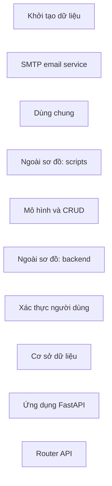

# full-stack-fastapi-template-cb740b6 — kết quả phân tích (bản sinh tự động)

- Snapshot: `snap:48597b2fdd287ad86cc29ce72b953974a5e80a8bd80724a4e7127483d7402ac9`
- Schema 0.1.0; renderer slice-render-v2; template slice-template-v1
- Phạm vi: 45 file trong 1 unit; 207 file bị loại khỏi snapshot

## Sơ đồ component

## Mục lục contract

- table: [tech-specs/MO-HINH-VA-CRUD/schema/TBL-FULL-STACK-FASTAPI-TEMPLATE-CB740B6-MO-HINH-VA-CRUD.md](tech-specs/MO-HINH-VA-CRUD/schema/TBL-FULL-STACK-FASTAPI-TEMPLATE-CB740B6-MO-HINH-VA-CRUD.md) — component `cmp_56c9ff88194fbd683a0587f3e7f23bc78f89ccb09fa12ec4e0fda9d3e2d9887e`

## Mục lục EVT theo topic

- (không có)

## Contract chưa gán được component

- (không có)

## Giới hạn

- `SLICE_SCOPE` (inventory): Lát cắt đầu chỉ nhận route FastAPI và bảng SQLAlchemy Column
- `PARSE_FAILED` (extraction): backend/app/api/deps.py: SyntaxError
- `ROUTER_NOT_MOUNTED` (extraction): backend/app/api/routes/items.py: backend.app.api.routes.items.read_items khai trên router chưa được gắn vào application nào
- `ROUTER_NOT_MOUNTED` (extraction): backend/app/api/routes/items.py: backend.app.api.routes.items.read_item khai trên router chưa được gắn vào application nào
- `ROUTER_NOT_MOUNTED` (extraction): backend/app/api/routes/items.py: backend.app.api.routes.items.create_item khai trên router chưa được gắn vào application nào
- `ROUTER_NOT_MOUNTED` (extraction): backend/app/api/routes/items.py: backend.app.api.routes.items.update_item khai trên router chưa được gắn vào application nào
- `ROUTER_NOT_MOUNTED` (extraction): backend/app/api/routes/items.py: backend.app.api.routes.items.delete_item khai trên router chưa được gắn vào application nào
- `ROUTER_NOT_MOUNTED` (extraction): backend/app/api/routes/login.py: backend.app.api.routes.login.login_access_token khai trên router chưa được gắn vào application nào
- `ROUTER_NOT_MOUNTED` (extraction): backend/app/api/routes/login.py: backend.app.api.routes.login.test_token khai trên router chưa được gắn vào application nào
- `ROUTER_NOT_MOUNTED` (extraction): backend/app/api/routes/login.py: backend.app.api.routes.login.recover_password khai trên router chưa được gắn vào application nào
- `ROUTER_NOT_MOUNTED` (extraction): backend/app/api/routes/login.py: backend.app.api.routes.login.reset_password khai trên router chưa được gắn vào application nào
- `ROUTER_NOT_MOUNTED` (extraction): backend/app/api/routes/login.py: backend.app.api.routes.login.recover_password_html_content khai trên router chưa được gắn vào application nào
- `ROUTER_NOT_MOUNTED` (extraction): backend/app/api/routes/private.py: backend.app.api.routes.private.create_user khai trên router chưa được gắn vào application nào
- `ROUTER_NOT_MOUNTED` (extraction): backend/app/api/routes/users.py: backend.app.api.routes.users.read_users khai trên router chưa được gắn vào application nào
- `ROUTER_NOT_MOUNTED` (extraction): backend/app/api/routes/users.py: backend.app.api.routes.users.create_user khai trên router chưa được gắn vào application nào
- `ROUTER_NOT_MOUNTED` (extraction): backend/app/api/routes/users.py: backend.app.api.routes.users.update_user_me khai trên router chưa được gắn vào application nào
- `ROUTER_NOT_MOUNTED` (extraction): backend/app/api/routes/users.py: backend.app.api.routes.users.update_password_me khai trên router chưa được gắn vào application nào
- `ROUTER_NOT_MOUNTED` (extraction): backend/app/api/routes/users.py: backend.app.api.routes.users.read_user_me khai trên router chưa được gắn vào application nào
- `ROUTER_NOT_MOUNTED` (extraction): backend/app/api/routes/users.py: backend.app.api.routes.users.delete_user_me khai trên router chưa được gắn vào application nào
- `ROUTER_NOT_MOUNTED` (extraction): backend/app/api/routes/users.py: backend.app.api.routes.users.register_user khai trên router chưa được gắn vào application nào
- `ROUTER_NOT_MOUNTED` (extraction): backend/app/api/routes/users.py: backend.app.api.routes.users.read_user_by_id khai trên router chưa được gắn vào application nào
- `ROUTER_NOT_MOUNTED` (extraction): backend/app/api/routes/users.py: backend.app.api.routes.users.update_user khai trên router chưa được gắn vào application nào
- `ROUTER_NOT_MOUNTED` (extraction): backend/app/api/routes/users.py: backend.app.api.routes.users.delete_user khai trên router chưa được gắn vào application nào
- `ROUTER_NOT_MOUNTED` (extraction): backend/app/api/routes/utils.py: backend.app.api.routes.utils.test_email khai trên router chưa được gắn vào application nào
- `ROUTER_NOT_MOUNTED` (extraction): backend/app/api/routes/utils.py: backend.app.api.routes.utils.health_check khai trên router chưa được gắn vào application nào
- `REFERENCE_UNRESOLVED` (extraction): 72 lời gọi chưa nối được đích; giữ là dữ kiện unresolved kèm lý do, không vẽ thành cạnh
- `MODEL_NOT_RUN` (model): Không gọi provider; tên component lấy từ membership
- `COMPONENT_WITHOUT_EVIDENCE` (verification): Ngoài sơ đồ: (gốc)

## Giới hạn biểu diễn

- `DDL_BLOCK_OMITTED`: Không bảng nào đủ dữ kiện cho DDL — `fact:bc55ebf0febfb292514d4a8da02096ec1d46d2fbc049f90747e81e9286e6d14f`, `fact:feca1457149e79086f4d45c6a15897d79c9a8713cbb6b42f3b0f022752df83cc`
- `DDL_TABLE_OMITTED`: dialect chưa biết — `fact:bc55ebf0febfb292514d4a8da02096ec1d46d2fbc049f90747e81e9286e6d14f`
- `DDL_TABLE_OMITTED`: dialect chưa biết — `fact:feca1457149e79086f4d45c6a15897d79c9a8713cbb6b42f3b0f022752df83cc`
