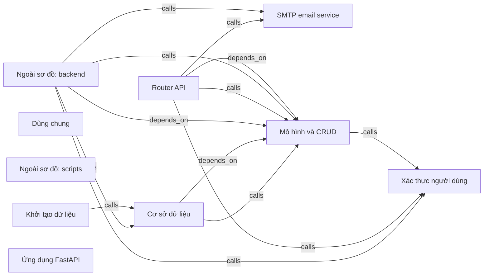

# full-stack-fastapi-template-cb740b6 — kết quả phân tích (bản sinh tự động)

- Snapshot: `snap:48597b2fdd287ad86cc29ce72b953974a5e80a8bd80724a4e7127483d7402ac9`
- Schema 0.1.0; renderer slice-render-v2; template slice-template-v1
- Phạm vi: 45 file trong 1 unit; 207 file bị loại khỏi snapshot

## Sơ đồ component

## Mục lục contract

- table: [tech-specs/MO-HINH-VA-CRUD/schema/TBL-FULL-STACK-FASTAPI-TEMPLATE-CB740B6-MO-HINH-VA-CRUD.md](tech-specs/MO-HINH-VA-CRUD/schema/TBL-FULL-STACK-FASTAPI-TEMPLATE-CB740B6-MO-HINH-VA-CRUD.md) — component `cmp_56c9ff88194fbd683a0587f3e7f23bc78f89ccb09fa12ec4e0fda9d3e2d9887e`
- api: [tech-specs/ROUTER-API/api/API-FULL-STACK-FASTAPI-TEMPLATE-CB740B6-ROUTER-API-v1.md](tech-specs/ROUTER-API/api/API-FULL-STACK-FASTAPI-TEMPLATE-CB740B6-ROUTER-API-v1.md) — component `cmp_ece7543ac7f97d7d6f35c953aa9b4ea3dcac3ce97361f2434f9a25db93414bc9`

## Mục lục EVT theo topic

- (không có)

## Contract chưa gán được component

- (không có)

## Giới hạn

- `SLICE_SCOPE` (inventory): Lát cắt đầu chỉ nhận route FastAPI và bảng SQLAlchemy Column
- `PARSE_FAILED` (extraction): backend/app/api/deps.py: SyntaxError
- `RUNTIME_DEPENDENT_PREFIX` (extraction): Prefix phụ thuộc lúc chạy: {settings.API_V1_STR}
- `RUNTIME_DEPENDENT_PREFIX` (extraction): Prefix phụ thuộc lúc chạy: {settings.API_V1_STR}
- `RUNTIME_DEPENDENT_PREFIX` (extraction): Prefix phụ thuộc lúc chạy: {settings.API_V1_STR}
- `RUNTIME_DEPENDENT_PREFIX` (extraction): Prefix phụ thuộc lúc chạy: {settings.API_V1_STR}
- `RUNTIME_DEPENDENT_PREFIX` (extraction): Prefix phụ thuộc lúc chạy: {settings.API_V1_STR}
- `RUNTIME_DEPENDENT_PREFIX` (extraction): Prefix phụ thuộc lúc chạy: {settings.API_V1_STR}
- `RUNTIME_DEPENDENT_PREFIX` (extraction): Prefix phụ thuộc lúc chạy: {settings.API_V1_STR}
- `RUNTIME_DEPENDENT_PREFIX` (extraction): Prefix phụ thuộc lúc chạy: {settings.API_V1_STR}
- `RUNTIME_DEPENDENT_PREFIX` (extraction): Prefix phụ thuộc lúc chạy: {settings.API_V1_STR}
- `RUNTIME_DEPENDENT_PREFIX` (extraction): Prefix phụ thuộc lúc chạy: {settings.API_V1_STR}
- `RUNTIME_DEPENDENT_PREFIX` (extraction): Prefix phụ thuộc lúc chạy: {settings.API_V1_STR}
- `RUNTIME_DEPENDENT_PREFIX` (extraction): Prefix phụ thuộc lúc chạy: {settings.API_V1_STR}
- `RUNTIME_DEPENDENT_PREFIX` (extraction): Prefix phụ thuộc lúc chạy: {settings.API_V1_STR}
- `RUNTIME_DEPENDENT_PREFIX` (extraction): Prefix phụ thuộc lúc chạy: {settings.API_V1_STR}
- `RUNTIME_DEPENDENT_PREFIX` (extraction): Prefix phụ thuộc lúc chạy: {settings.API_V1_STR}
- `RUNTIME_DEPENDENT_PREFIX` (extraction): Prefix phụ thuộc lúc chạy: {settings.API_V1_STR}
- `RUNTIME_DEPENDENT_PREFIX` (extraction): Prefix phụ thuộc lúc chạy: {settings.API_V1_STR}
- `RUNTIME_DEPENDENT_PREFIX` (extraction): Prefix phụ thuộc lúc chạy: {settings.API_V1_STR}
- `RUNTIME_DEPENDENT_PREFIX` (extraction): Prefix phụ thuộc lúc chạy: {settings.API_V1_STR}
- `RUNTIME_DEPENDENT_PREFIX` (extraction): Prefix phụ thuộc lúc chạy: {settings.API_V1_STR}
- `RUNTIME_DEPENDENT_PREFIX` (extraction): Prefix phụ thuộc lúc chạy: {settings.API_V1_STR}
- `RUNTIME_DEPENDENT_PREFIX` (extraction): Prefix phụ thuộc lúc chạy: {settings.API_V1_STR}
- `RUNTIME_DEPENDENT_PREFIX` (extraction): Prefix phụ thuộc lúc chạy: {settings.API_V1_STR}
- `REFERENCE_UNRESOLVED` (extraction): 103 lời gọi chưa nối được đích; giữ là dữ kiện unresolved kèm lý do, không vẽ thành cạnh
- `MODEL_NOT_RUN` (model): Không gọi provider; tên component lấy từ membership
- `COMPONENT_WITHOUT_EVIDENCE` (verification): Ngoài sơ đồ: (gốc)

## Giới hạn biểu diễn

- `DDL_BLOCK_OMITTED`: Không bảng nào đủ dữ kiện cho DDL — `fact:bc55ebf0febfb292514d4a8da02096ec1d46d2fbc049f90747e81e9286e6d14f`, `fact:feca1457149e79086f4d45c6a15897d79c9a8713cbb6b42f3b0f022752df83cc`
- `DDL_TABLE_OMITTED`: dialect chưa biết — `fact:bc55ebf0febfb292514d4a8da02096ec1d46d2fbc049f90747e81e9286e6d14f`
- `DDL_TABLE_OMITTED`: dialect chưa biết — `fact:feca1457149e79086f4d45c6a15897d79c9a8713cbb6b42f3b0f022752df83cc`
- `OPENAPI_BLOCK_OMITTED`: Không route nào đủ method, path đầy đủ và status code — `fact:0565c24d1a663897d7a52da6d2ee6bae26ffca22a5418e718f96b5935a365a03`, `fact:211944e8539a2b8aa1b5aa80cac995d3b9c3b734e0667b9c69f28447f9469467`, `fact:288e9e25b4053dc25ae2a792e7f66189d8e6a41899631fd3f679f00f3113682c`, `fact:34e7d7bc2be8d6e3b893b4e871cb5717d7e0d1720cba6a5692691fa03104e9fd`, `fact:3e201257ba6dca2980276dafe5cf31e24b69ebee769421788ad2c32781d3e117`, `fact:3fdba003fe284427eeb5d1c49f07f4e96dbfbbc1c609bf53636050e5d3707655`, `fact:483698421bf2f7dadcfd0db55584b3b3533a6ffdc2fab22bc167482f32cfe708`, `fact:592222f93121438176f8be03ee2b355be360cc0888cd739064446d7747659852`, `fact:5f940df2875564384cc481fcff53305451d7fc85b615eb71624f8f766ffc8455`, `fact:69a36c722f6777d962ab7baffe6b92d7e576191601854885b656c775fb0db87d`, `fact:6f0731c8b2622351fb6492e6cc0c20d12b7a459059196282876d47edd6efc7e9`, `fact:6f5671770f3e62d7ae6d4b1fc95c3358065cd7604796317f5baed8fc90cef046`, `fact:7008485e465b6acb894957f88465f21cf0c0672219948f2ec69f814df21de25b`, `fact:87dc6c3972b2403331fa2746eeec21dbf3ccbc8e963b9540780dabcc7794ba84`, `fact:8dfd6cdd3263e14449269b5079042316df964571caa33c9e9b03c0233a5599a2`, `fact:b35c7f7066bfc703d9b8fde8d0a2bb9c6207fc70ab5b8809e87a908ffdad0115`, `fact:c0cc5671b145a65bceb084fe6fee6bdf45c2fd74c206aaf6d17465c837c260d4`, `fact:c408685844538d3d68492b8da4a7322c73f545ce5ec702f4c346e952b6447036`, `fact:ca6a9bfdea5bdbb56bdde5429d116f9a7b451122ce954dd0b2ae270075e67cb8`, `fact:cb4f98fea70376f31f6a1f8d3e816547aa26bea10d0d35227af9b44ec8d49c19`, `fact:d46b020437dbfd11d302c75fe18d59a0f37370dac74f3c855f6006d2fd2ce33b`, `fact:e02881d4c9d5b6b1deecc103422bb2d89a9596fc87ffea1ce4e52b25daeb7aa3`, `fact:fb2e216fec9e12260f410da5cce0925353b4a718516732ff2582489b4fb68a03`
- `OPENAPI_OPERATION_OMITTED`: Path đầy đủ chưa biết — `fact:0565c24d1a663897d7a52da6d2ee6bae26ffca22a5418e718f96b5935a365a03`
- `OPENAPI_OPERATION_OMITTED`: Path đầy đủ chưa biết — `fact:211944e8539a2b8aa1b5aa80cac995d3b9c3b734e0667b9c69f28447f9469467`
- `OPENAPI_OPERATION_OMITTED`: Path đầy đủ chưa biết — `fact:288e9e25b4053dc25ae2a792e7f66189d8e6a41899631fd3f679f00f3113682c`
- `OPENAPI_OPERATION_OMITTED`: Path đầy đủ chưa biết — `fact:34e7d7bc2be8d6e3b893b4e871cb5717d7e0d1720cba6a5692691fa03104e9fd`
- `OPENAPI_OPERATION_OMITTED`: Path đầy đủ chưa biết — `fact:3e201257ba6dca2980276dafe5cf31e24b69ebee769421788ad2c32781d3e117`
- `OPENAPI_OPERATION_OMITTED`: Path đầy đủ chưa biết — `fact:3fdba003fe284427eeb5d1c49f07f4e96dbfbbc1c609bf53636050e5d3707655`
- `OPENAPI_OPERATION_OMITTED`: Path đầy đủ chưa biết — `fact:483698421bf2f7dadcfd0db55584b3b3533a6ffdc2fab22bc167482f32cfe708`
- `OPENAPI_OPERATION_OMITTED`: Path đầy đủ chưa biết — `fact:592222f93121438176f8be03ee2b355be360cc0888cd739064446d7747659852`
- `OPENAPI_OPERATION_OMITTED`: Path đầy đủ chưa biết — `fact:5f940df2875564384cc481fcff53305451d7fc85b615eb71624f8f766ffc8455`
- `OPENAPI_OPERATION_OMITTED`: Path đầy đủ chưa biết — `fact:69a36c722f6777d962ab7baffe6b92d7e576191601854885b656c775fb0db87d`
- `OPENAPI_OPERATION_OMITTED`: Path đầy đủ chưa biết — `fact:6f0731c8b2622351fb6492e6cc0c20d12b7a459059196282876d47edd6efc7e9`
- `OPENAPI_OPERATION_OMITTED`: Path đầy đủ chưa biết — `fact:6f5671770f3e62d7ae6d4b1fc95c3358065cd7604796317f5baed8fc90cef046`
- `OPENAPI_OPERATION_OMITTED`: Path đầy đủ chưa biết — `fact:7008485e465b6acb894957f88465f21cf0c0672219948f2ec69f814df21de25b`
- `OPENAPI_OPERATION_OMITTED`: Path đầy đủ chưa biết — `fact:87dc6c3972b2403331fa2746eeec21dbf3ccbc8e963b9540780dabcc7794ba84`
- `OPENAPI_OPERATION_OMITTED`: Path đầy đủ chưa biết — `fact:8dfd6cdd3263e14449269b5079042316df964571caa33c9e9b03c0233a5599a2`
- `OPENAPI_OPERATION_OMITTED`: Path đầy đủ chưa biết — `fact:b35c7f7066bfc703d9b8fde8d0a2bb9c6207fc70ab5b8809e87a908ffdad0115`
- `OPENAPI_OPERATION_OMITTED`: Path đầy đủ chưa biết — `fact:c0cc5671b145a65bceb084fe6fee6bdf45c2fd74c206aaf6d17465c837c260d4`
- `OPENAPI_OPERATION_OMITTED`: Path đầy đủ chưa biết — `fact:c408685844538d3d68492b8da4a7322c73f545ce5ec702f4c346e952b6447036`
- `OPENAPI_OPERATION_OMITTED`: Path đầy đủ chưa biết — `fact:ca6a9bfdea5bdbb56bdde5429d116f9a7b451122ce954dd0b2ae270075e67cb8`
- `OPENAPI_OPERATION_OMITTED`: Path đầy đủ chưa biết — `fact:cb4f98fea70376f31f6a1f8d3e816547aa26bea10d0d35227af9b44ec8d49c19`
- `OPENAPI_OPERATION_OMITTED`: Path đầy đủ chưa biết — `fact:d46b020437dbfd11d302c75fe18d59a0f37370dac74f3c855f6006d2fd2ce33b`
- `OPENAPI_OPERATION_OMITTED`: Path đầy đủ chưa biết — `fact:e02881d4c9d5b6b1deecc103422bb2d89a9596fc87ffea1ce4e52b25daeb7aa3`
- `OPENAPI_OPERATION_OMITTED`: Path đầy đủ chưa biết — `fact:fb2e216fec9e12260f410da5cce0925353b4a718516732ff2582489b4fb68a03`
