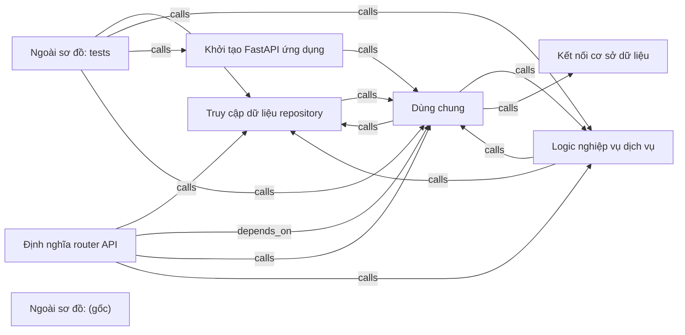

# fastapi-realworld-diagram — kết quả phân tích (bản sinh tự động)

- Snapshot: `snap:cc11d7d982bab274bbbbf8ea295de7483f55b060e6658200582a2e4b7dd00e16`
- Schema 0.1.0; renderer slice-render-v2; template slice-template-v1
- Phạm vi: 96 file trong 1 unit; 29 file bị loại khỏi snapshot

## Sơ đồ component

## Mục lục contract

- api: [tech-specs/DINH-NGHIA-ROUTER-API/api/API-FASTAPI-REALWORLD-DIAGRAM-DINH-NGHIA-ROUTER-API-v1.md](tech-specs/DINH-NGHIA-ROUTER-API/api/API-FASTAPI-REALWORLD-DIAGRAM-DINH-NGHIA-ROUTER-API-v1.md) — component `cmp_0b7ea9bdc14e04bf245084a756a7452dcfbcc03f0246020977e6dd1cc705fbb4`

## Mục lục EVT theo topic

- (không có)

## Contract chưa gán được component

- (không có)

## Giới hạn

- `SLICE_SCOPE` (inventory): Lát cắt đầu chỉ nhận route FastAPI và bảng SQLAlchemy Column
- `RUNTIME_DEPENDENT_PREFIX` (extraction): Prefix phụ thuộc lúc chạy: {settings.api_prefix}
- `RUNTIME_DEPENDENT_PREFIX` (extraction): Prefix phụ thuộc lúc chạy: {settings.api_prefix}
- `RUNTIME_DEPENDENT_PREFIX` (extraction): Prefix phụ thuộc lúc chạy: {settings.api_prefix}
- `RUNTIME_DEPENDENT_PREFIX` (extraction): Prefix phụ thuộc lúc chạy: {settings.api_prefix}
- `RUNTIME_DEPENDENT_PREFIX` (extraction): Prefix phụ thuộc lúc chạy: {settings.api_prefix}
- `RUNTIME_DEPENDENT_PREFIX` (extraction): Prefix phụ thuộc lúc chạy: {settings.api_prefix}
- `RUNTIME_DEPENDENT_PREFIX` (extraction): Prefix phụ thuộc lúc chạy: {settings.api_prefix}
- `RUNTIME_DEPENDENT_PREFIX` (extraction): Prefix phụ thuộc lúc chạy: {settings.api_prefix}
- `RUNTIME_DEPENDENT_PREFIX` (extraction): Prefix phụ thuộc lúc chạy: {settings.api_prefix}
- `RUNTIME_DEPENDENT_PREFIX` (extraction): Prefix phụ thuộc lúc chạy: {settings.api_prefix}
- `RUNTIME_DEPENDENT_PREFIX` (extraction): Prefix phụ thuộc lúc chạy: {settings.api_prefix}
- `RUNTIME_DEPENDENT_PREFIX` (extraction): Prefix phụ thuộc lúc chạy: {settings.api_prefix}
- `RUNTIME_DEPENDENT_PREFIX` (extraction): Prefix phụ thuộc lúc chạy: {settings.api_prefix}
- `RUNTIME_DEPENDENT_PREFIX` (extraction): Prefix phụ thuộc lúc chạy: {settings.api_prefix}
- `RUNTIME_DEPENDENT_PREFIX` (extraction): Prefix phụ thuộc lúc chạy: {settings.api_prefix}
- `RUNTIME_DEPENDENT_PREFIX` (extraction): Prefix phụ thuộc lúc chạy: {settings.api_prefix}
- `RUNTIME_DEPENDENT_PREFIX` (extraction): Prefix phụ thuộc lúc chạy: {settings.api_prefix}
- `RUNTIME_DEPENDENT_PREFIX` (extraction): Prefix phụ thuộc lúc chạy: {settings.api_prefix}
- `RUNTIME_DEPENDENT_PREFIX` (extraction): Prefix phụ thuộc lúc chạy: {settings.api_prefix}
- `TABLES_IN_MIGRATIONS_NOT_READ` (extraction): 7 bảng chỉ thấy trong migration Alembic, chưa trích: articles, articles_to_tags, commentaries, favorites, followers_to_followings, tags, users
- `REFERENCE_UNRESOLVED` (extraction): 73 lời gọi chưa nối được đích; giữ là dữ kiện unresolved kèm lý do, không vẽ thành cạnh
- `MODEL_NOT_RUN` (model): Không gọi provider; tên component lấy từ membership

## Giới hạn biểu diễn

- `OPENAPI_BLOCK_OMITTED`: Không route nào đủ method, path đầy đủ và status code — `fact:1605dbd217661e2b63950870e86ca3295cb9f87fda9cf69eb0a13c16acf3074e`, `fact:178439e3fcc687273f36938a4e6b1bc317c06f1254587158cbf9e69fe022e510`, `fact:20763ab9808a0f95f5cd6965dd50fd82cd4502b4ee1dd3fac51f62eb618bd3a0`, `fact:2c14c83d53975b50a3febcf41a183b9d9b6dbe17d8667b5d31d2593320f8c842`, `fact:4981c8b96f32e5b3102210046a1b35b8a51e9a59a0843ce038df91ad92daa108`, `fact:53edc9f50ec759cdd501a4970658f4b08b4a9a18ff13d7c8462990bceacada72`, `fact:5c14cb68a553113bd67e55db63e6043eb7e3ed30aa239a9b357673c9cb8a82ad`, `fact:72e0a3ae85df18d817bc6400a2acff3c6ef9311ce520ce68019fa37a97d97894`, `fact:7c42df4aa3a3b9ed8539ca867777cafdd3f9944528d0e86f424aad3c4971ee4d`, `fact:9e141ee1d65b483c05d8ede4db3e24a975b194385470d7aeb50537867892458f`, `fact:a89bcde0d60b08200324ff43f0c4c7d5d4ed31a2ef1addbd712fb2d6481cc092`, `fact:b5f8f498f5cc7b9d50ed15b94f0d286e2337b9d4f5185fb490a66850a379ab9a`, `fact:bb0d673f45a31ed997303f33c149b6ca780e83df7c9759692a1e5e086543933e`, `fact:cc0df5f8cd7f1da8cb77d908a0298def6b0bff126ab1e8d0b56a89a24038c629`, `fact:d1e4faa1ae82e6974488e66cd732ed0f50fa8f0368cfa8fa7e59ca155fcb74e5`, `fact:d80f4275b2ccf71c228db08148c6b94be6dfca672d2002afbc82bed6dbe62a9a`, `fact:de90fa73eae5c7276db0a19b519d2e7886b5bd12204633cdf599b2f8efbd9d11`, `fact:f9d5d0d06b9d0f6a32b2460e01a7b0afe31c30b2d51e105e64e2e560c36b5624`, `fact:fa1c6889f974ab44aea6c1d6c1556f801cfa1d232cad201aaa13dbca036995c7`
- `OPENAPI_OPERATION_OMITTED`: Path đầy đủ chưa biết — `fact:1605dbd217661e2b63950870e86ca3295cb9f87fda9cf69eb0a13c16acf3074e`
- `OPENAPI_OPERATION_OMITTED`: Path đầy đủ chưa biết — `fact:178439e3fcc687273f36938a4e6b1bc317c06f1254587158cbf9e69fe022e510`
- `OPENAPI_OPERATION_OMITTED`: Path đầy đủ chưa biết — `fact:20763ab9808a0f95f5cd6965dd50fd82cd4502b4ee1dd3fac51f62eb618bd3a0`
- `OPENAPI_OPERATION_OMITTED`: Path đầy đủ chưa biết — `fact:2c14c83d53975b50a3febcf41a183b9d9b6dbe17d8667b5d31d2593320f8c842`
- `OPENAPI_OPERATION_OMITTED`: Path đầy đủ chưa biết — `fact:4981c8b96f32e5b3102210046a1b35b8a51e9a59a0843ce038df91ad92daa108`
- `OPENAPI_OPERATION_OMITTED`: Path đầy đủ chưa biết — `fact:53edc9f50ec759cdd501a4970658f4b08b4a9a18ff13d7c8462990bceacada72`
- `OPENAPI_OPERATION_OMITTED`: Path đầy đủ chưa biết — `fact:5c14cb68a553113bd67e55db63e6043eb7e3ed30aa239a9b357673c9cb8a82ad`
- `OPENAPI_OPERATION_OMITTED`: Path đầy đủ chưa biết — `fact:72e0a3ae85df18d817bc6400a2acff3c6ef9311ce520ce68019fa37a97d97894`
- `OPENAPI_OPERATION_OMITTED`: Path đầy đủ chưa biết — `fact:7c42df4aa3a3b9ed8539ca867777cafdd3f9944528d0e86f424aad3c4971ee4d`
- `OPENAPI_OPERATION_OMITTED`: Path đầy đủ chưa biết — `fact:9e141ee1d65b483c05d8ede4db3e24a975b194385470d7aeb50537867892458f`
- `OPENAPI_OPERATION_OMITTED`: Path đầy đủ chưa biết — `fact:a89bcde0d60b08200324ff43f0c4c7d5d4ed31a2ef1addbd712fb2d6481cc092`
- `OPENAPI_OPERATION_OMITTED`: Path đầy đủ chưa biết — `fact:b5f8f498f5cc7b9d50ed15b94f0d286e2337b9d4f5185fb490a66850a379ab9a`
- `OPENAPI_OPERATION_OMITTED`: Path đầy đủ chưa biết — `fact:bb0d673f45a31ed997303f33c149b6ca780e83df7c9759692a1e5e086543933e`
- `OPENAPI_OPERATION_OMITTED`: Path đầy đủ chưa biết — `fact:cc0df5f8cd7f1da8cb77d908a0298def6b0bff126ab1e8d0b56a89a24038c629`
- `OPENAPI_OPERATION_OMITTED`: Path đầy đủ chưa biết — `fact:d1e4faa1ae82e6974488e66cd732ed0f50fa8f0368cfa8fa7e59ca155fcb74e5`
- `OPENAPI_OPERATION_OMITTED`: Path đầy đủ chưa biết — `fact:d80f4275b2ccf71c228db08148c6b94be6dfca672d2002afbc82bed6dbe62a9a`
- `OPENAPI_OPERATION_OMITTED`: Path đầy đủ chưa biết — `fact:de90fa73eae5c7276db0a19b519d2e7886b5bd12204633cdf599b2f8efbd9d11`
- `OPENAPI_OPERATION_OMITTED`: Path đầy đủ chưa biết — `fact:f9d5d0d06b9d0f6a32b2460e01a7b0afe31c30b2d51e105e64e2e560c36b5624`
- `OPENAPI_OPERATION_OMITTED`: Path đầy đủ chưa biết — `fact:fa1c6889f974ab44aea6c1d6c1556f801cfa1d232cad201aaa13dbca036995c7`
