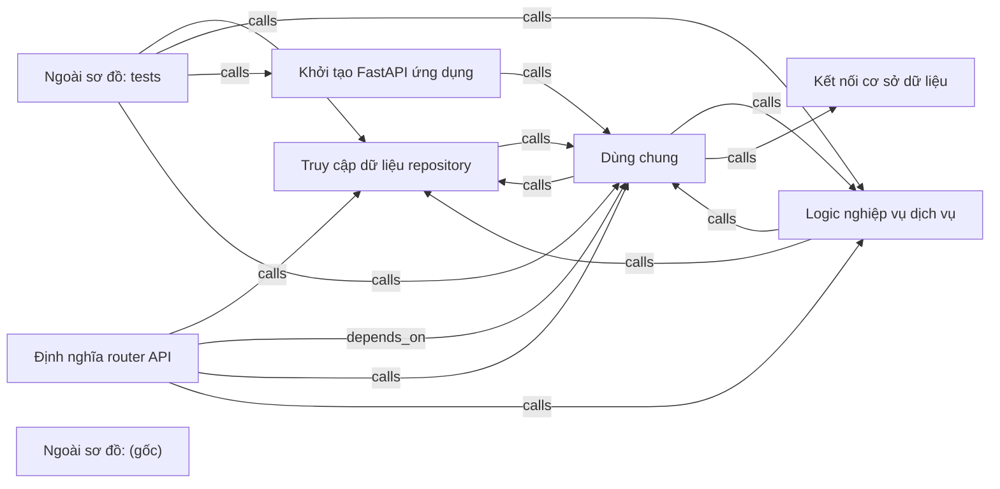

# fastapi-realworld-diagram — kết quả phân tích (bản sinh tự động)

- Snapshot: `snap:cc11d7d982bab274bbbbf8ea295de7483f55b060e6658200582a2e4b7dd00e16`
- Schema 0.1.0; renderer slice-render-v2; template slice-template-v1
- Phạm vi: 96 file trong 1 unit; 29 file bị loại khỏi snapshot

## Sơ đồ component

## Mục lục contract

- api: [tech-specs/DINH-NGHIA-ROUTER-API/api/API-FASTAPI-REALWORLD-DIAGRAM-DINH-NGHIA-ROUTER-API-v1.md](tech-specs/DINH-NGHIA-ROUTER-API/api/API-FASTAPI-REALWORLD-DIAGRAM-DINH-NGHIA-ROUTER-API-v1.md) — component `cmp_0b7ea9bdc14e04bf245084a756a7452dcfbcc03f0246020977e6dd1cc705fbb4`

## Mục lục EVT theo topic

- (không có)

## Contract chưa gán được component

- (không có)

## Giới hạn

- `SLICE_SCOPE` (inventory): Lát cắt đầu chỉ nhận route FastAPI và bảng SQLAlchemy Column
- `TABLES_IN_MIGRATIONS_NOT_READ` (extraction): 7 bảng chỉ thấy trong migration Alembic, chưa trích: articles, articles_to_tags, commentaries, favorites, followers_to_followings, tags, users
- `REFERENCE_UNRESOLVED` (extraction): 73 lời gọi chưa nối được đích; giữ là dữ kiện unresolved kèm lý do, không vẽ thành cạnh
- `MODEL_NOT_RUN` (model): Không gọi provider; tên component lấy từ membership

## Giới hạn biểu diễn

- (không có)
