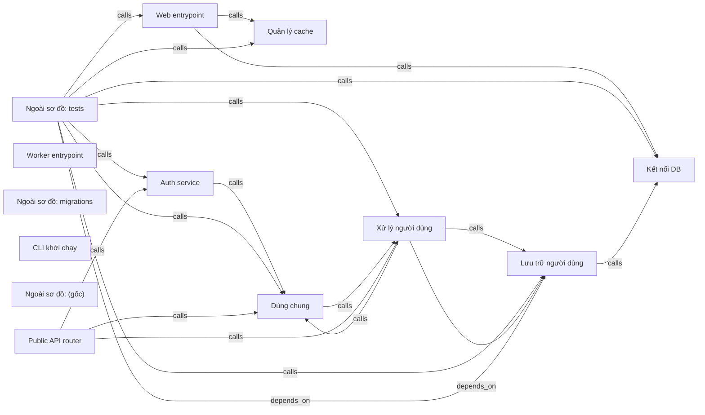

# teamhide_fastapi-boilerplate-df4e6d4 — kết quả phân tích (bản sinh tự động)

- Snapshot: `snap:96f8c4c9bb1fbd6f13ba0f2b1a22b3c98fb3e718c6744a39e04ab68535bb4a3f`
- Schema 0.1.0; renderer slice-render-v2; template slice-template-v1
- Phạm vi: 125 file trong 1 unit; 11 file bị loại khỏi snapshot

## Sơ đồ component

## Mục lục contract

- table: [tech-specs/LUU-TRU-NGUOI-DUNG/schema/TBL-TEAMHIDE-FASTAPI-BOILERPLATE-DF4E6D4-LUU-TRU-NGUOI-DUNG.md](tech-specs/LUU-TRU-NGUOI-DUNG/schema/TBL-TEAMHIDE-FASTAPI-BOILERPLATE-DF4E6D4-LUU-TRU-NGUOI-DUNG.md) — component `cmp_95405d59cd1bf6793aaabbd1b2d696e9fe7a60b0fff12b43107b53c242f65a4a`
- api: [tech-specs/PUBLIC-API-ROUTER/api/API-TEAMHIDE-FASTAPI-BOILERPLATE-DF4E6D4-PUBLIC-API-ROUTER-v1.md](tech-specs/PUBLIC-API-ROUTER/api/API-TEAMHIDE-FASTAPI-BOILERPLATE-DF4E6D4-PUBLIC-API-ROUTER-v1.md) — component `cmp_bfc26ab6cf618b4444fbaa84f29ba0f77c1a5fdff6b9c679cf9218caa28e7516`

## Mục lục EVT theo topic

- (không có)

## Contract chưa gán được component

- (không có)

## Giới hạn

- `SLICE_SCOPE` (inventory): Lát cắt đầu chỉ nhận route FastAPI và bảng SQLAlchemy Column
- `REFERENCE_UNRESOLVED` (extraction): 114 lời gọi chưa nối được đích; giữ là dữ kiện unresolved kèm lý do, không vẽ thành cạnh
- `VALUE_REDACTED` (extraction): Giá trị có dấu hiệu credential đã được che trước khi lưu
- `MODEL_NOT_RUN` (model): Không gọi provider; tên component lấy từ membership

## Giới hạn biểu diễn

- `DDL_BLOCK_OMITTED`: Không bảng nào đủ dữ kiện cho DDL — `fact:8cc7f2347c01991ba09383b9e750166a40ac852dd0ad3530d07a8b3998c2460c`
- `DDL_TABLE_OMITTED`: dialect chưa biết — `fact:8cc7f2347c01991ba09383b9e750166a40ac852dd0ad3530d07a8b3998c2460c`
- `OPENAPI_BLOCK_OMITTED`: Không route nào đủ method, path đầy đủ và status code — `fact:38feeffcb0cf6c5ddf1d3cbaad882692413b2abf1c39c4e96c68eeefb4580378`, `fact:442ab82adbd1d4490249ec1092e3cc0c88af2b72ee5fecff0f729a4ff0363194`, `fact:44de75a521fe0c25842355f8575018f4d2630b9efe65f419d3b936bb71ff6703`, `fact:635e3e9b2e791a0b950ce5af33b71cc1af5eaa14c389a115ee792ebda7226d51`, `fact:ec85316077d1ae8e30dd04f6f1f1be88d768a0c52d27a00aaa0ec205a052a60d`
- `OPENAPI_OPERATION_OMITTED`: Status code chưa biết — `fact:38feeffcb0cf6c5ddf1d3cbaad882692413b2abf1c39c4e96c68eeefb4580378`
- `OPENAPI_OPERATION_OMITTED`: Status code chưa biết — `fact:442ab82adbd1d4490249ec1092e3cc0c88af2b72ee5fecff0f729a4ff0363194`
- `OPENAPI_OPERATION_OMITTED`: Status code chưa biết — `fact:44de75a521fe0c25842355f8575018f4d2630b9efe65f419d3b936bb71ff6703`
- `OPENAPI_OPERATION_OMITTED`: Status code chưa biết — `fact:635e3e9b2e791a0b950ce5af33b71cc1af5eaa14c389a115ee792ebda7226d51`
- `OPENAPI_OPERATION_OMITTED`: Status code chưa biết — `fact:ec85316077d1ae8e30dd04f6f1f1be88d768a0c52d27a00aaa0ec205a052a60d`
