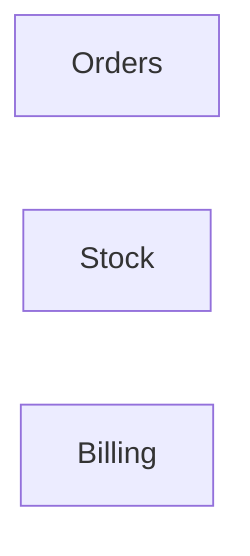

# events — kết quả phân tích (bản sinh tự động)

- Snapshot: `snap:20e4de95ced5b5f417e45b6d7dd6e78414bca499e969062afd15480b7ea70490`
- Schema 0.1.0; renderer slice-render-v2; template slice-template-v1
- Phạm vi: 3 file trong 1 unit; 0 file bị loại khỏi snapshot

## Sơ đồ component

## Mục lục contract

- (không có)

## Mục lục EVT theo topic

- (không có)

## Contract chưa gán được component

- (không có)

## Giới hạn

- `SLICE_SCOPE` (inventory): Lát cắt đầu chỉ nhận route FastAPI và bảng SQLAlchemy Column
- `MODEL_NOT_RUN` (model): Không gọi provider; tên component lấy từ membership

## Giới hạn biểu diễn

- (không có)
