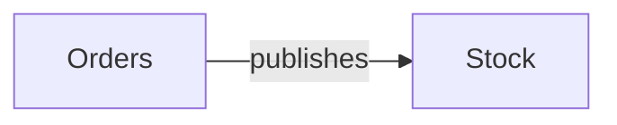

# kafka — kết quả phân tích (bản sinh tự động)

- Snapshot: `snap:193008397fc6e5a13fa5f1b7e8adbca4357fea55797a181e0b72f3e7c058bf09`
- Schema 0.1.0; renderer slice-render-v2; template slice-template-v1
- Phạm vi: 2 file trong 1 unit; 0 file bị loại khỏi snapshot

## Sơ đồ component

## Mục lục contract

- event: [tech-specs/STOCK/events/EVT-KAFKA-STOCK-ORDER-CREATED.md](tech-specs/STOCK/events/EVT-KAFKA-STOCK-ORDER-CREATED.md) — component `cmp_053e352ca24100eb6bff9b5feaf362811e73d59dec0647ec9bd45c2869035cd3`
- event: [tech-specs/ORDERS/events/EVT-KAFKA-ORDERS-ORDER-CREATED.md](tech-specs/ORDERS/events/EVT-KAFKA-ORDERS-ORDER-CREATED.md) — component `cmp_b99af8888eed0555ea9cd3ceb3162fe572f70056691b80c883abef994dbde1fa`

## Mục lục EVT theo topic

- order-created: [tech-specs/STOCK/events/EVT-KAFKA-STOCK-ORDER-CREATED.md](tech-specs/STOCK/events/EVT-KAFKA-STOCK-ORDER-CREATED.md) (consume); [tech-specs/ORDERS/events/EVT-KAFKA-ORDERS-ORDER-CREATED.md](tech-specs/ORDERS/events/EVT-KAFKA-ORDERS-ORDER-CREATED.md) (publish)

## Contract chưa gán được component

- (không có)

## Giới hạn

- `SLICE_SCOPE` (inventory): Lát cắt đầu chỉ nhận route FastAPI và bảng SQLAlchemy Column
- `MODEL_NOT_RUN` (model): Không gọi provider; tên component lấy từ membership

## Giới hạn biểu diễn

- `EVENT_BINDING_UNRESOLVED`: Chưa chứng minh broker/namespace/serialization/topic; điểm này giữ riêng — `fact:83e0f5ee0813baedbf0e41e675a278fd553613c6e4a2bc70c82bcf9ff637b540`
- `EVENT_BINDING_UNRESOLVED`: Chưa chứng minh broker/namespace/serialization/topic; điểm này giữ riêng — `fact:f4b9d6de1bd3516522a009e570c0caa078b452a5a476f9de34d3f4de8ca5914e`
- `EVENT_PAYLOAD_UNKNOWN`: Payload không có schema đọc được — `fact:83e0f5ee0813baedbf0e41e675a278fd553613c6e4a2bc70c82bcf9ff637b540`
- `EVENT_PAYLOAD_UNKNOWN`: Payload không có schema đọc được — `fact:f4b9d6de1bd3516522a009e570c0caa078b452a5a476f9de34d3f4de8ca5914e`
