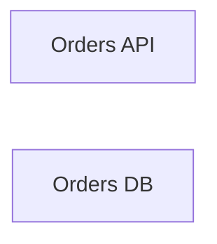

# shop_partial — kết quả phân tích (bản sinh tự động)

- Snapshot: `snap:635b641f86bb84e0f7ffb93ce783c06e41c8c910708a20838997b48c8d11d2f4`
- Schema 0.1.0; renderer slice-render-v2; template slice-template-v1
- Phạm vi: 3 file trong 1 unit; 0 file bị loại khỏi snapshot

## Sơ đồ component

## Mục lục contract

- api: [tech-specs/ORDERS-API/api/API-SHOP-PARTIAL-ORDERS-API-v1.md](tech-specs/ORDERS-API/api/API-SHOP-PARTIAL-ORDERS-API-v1.md) — component `cmp_82f84192155a15f7481f767abbcc66d389beb9a8da98a72ecdb0ea4be815ceeb`
- table: [tech-specs/ORDERS-DB/schema/TBL-SHOP-PARTIAL-ORDERS-DB.md](tech-specs/ORDERS-DB/schema/TBL-SHOP-PARTIAL-ORDERS-DB.md) — component `cmp_ec5ecd4006c93338b0efaa089a6cfd839fd5080a1ec15a0aad228557672c5c3f`

## Mục lục EVT theo topic

- (không có)

## Contract chưa gán được component

- (không có)

## Giới hạn

- `SLICE_SCOPE` (inventory): Lát cắt đầu chỉ nhận route FastAPI và bảng SQLAlchemy Column
- `RUNTIME_DEPENDENT_PREFIX` (extraction): Prefix phụ thuộc lúc chạy: {os.environ['API_PREFIX']}
- `MODEL_NOT_RUN` (model): Không gọi provider; tên component lấy từ membership

## Giới hạn biểu diễn

- `DDL_BLOCK_OMITTED`: Không bảng nào đủ dữ kiện cho DDL — `fact:b77b978a3e9157f4ef684ea53660f58fbd3c576a1b136528343c2cceb2e081dc`
- `DDL_TABLE_OMITTED`: dialect chưa biết — `fact:b77b978a3e9157f4ef684ea53660f58fbd3c576a1b136528343c2cceb2e081dc`
- `OPENAPI_BLOCK_OMITTED`: Không route nào đủ method, path đầy đủ và status code — `fact:8cf689a8cf7d4875d3e9bbdc6e72eb2c637dd8d527da62515db5c050f9177ea3`
- `OPENAPI_OPERATION_OMITTED`: Path đầy đủ chưa biết — `fact:8cf689a8cf7d4875d3e9bbdc6e72eb2c637dd8d527da62515db5c050f9177ea3`
