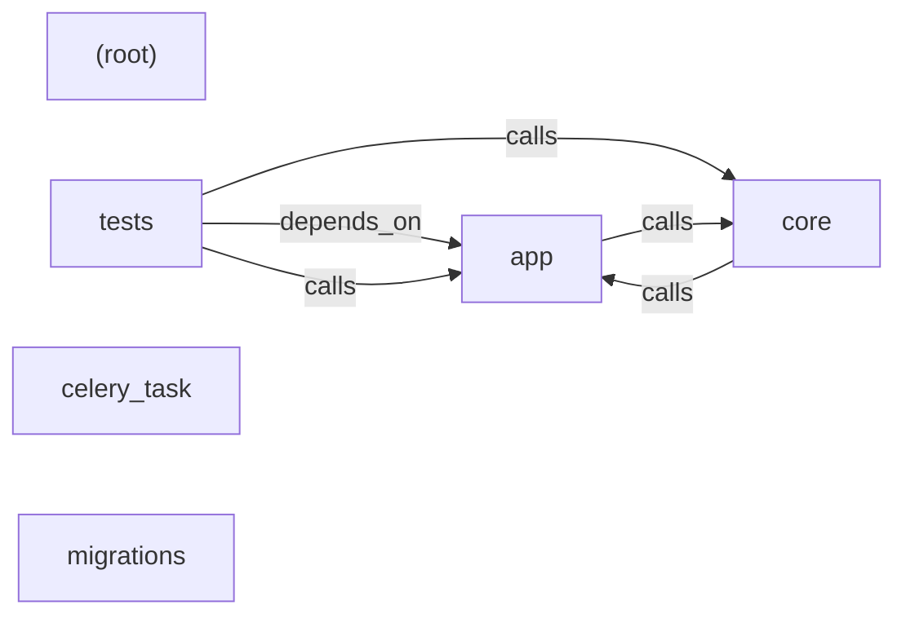

# teamhide — kết quả phân tích (bản sinh tự động)

- Snapshot: `snap:96f8c4c9bb1fbd6f13ba0f2b1a22b3c98fb3e718c6744a39e04ab68535bb4a3f`
- Schema 0.1.0; renderer slice-render-v3; template slice-template-v1
- Phạm vi: 125 file trong 1 unit; 11 file bị loại khỏi snapshot

## Sơ đồ component

## Mục lục contract

- api: [tech-specs/APP/api/API-TEAMHIDE-APP-v1.md](tech-specs/APP/api/API-TEAMHIDE-APP-v1.md) — component `cmp_12d7d6dab50f5377fd0c280ca19070f9043a8faa56bfc993ec74450799ac2d0a`
- table: [tech-specs/APP/schema/TBL-TEAMHIDE-APP.md](tech-specs/APP/schema/TBL-TEAMHIDE-APP.md) — component `cmp_12d7d6dab50f5377fd0c280ca19070f9043a8faa56bfc993ec74450799ac2d0a`

## Mục lục EVT theo topic

- (không có)

## Contract chưa gán được component

- (không có)

## Lời gọi HTTP ra ngoài

- (không có)

## Giới hạn

- `SLICE_SCOPE` (inventory): Lát cắt đầu chỉ nhận route FastAPI và bảng SQLAlchemy Column
- `QUEUE_LIBRARY_UNSUPPORTED` (extraction): Dùng thư viện hàng đợi/sự kiện chưa hỗ trợ, chưa trích bên gửi/nhận: celery (celery_task/__init__.py:1)
- `REFERENCE_UNRESOLVED` (extraction): 114 lời gọi chưa nối được đích; giữ là dữ kiện unresolved kèm lý do, không vẽ thành cạnh
- `VALUE_REDACTED` (extraction): Giá trị có dấu hiệu credential đã được che trước khi lưu
- `MODEL_NOT_RUN` (model): Không gọi provider; tên component lấy từ membership

## Giới hạn biểu diễn

- `DDL_BLOCK_OMITTED`: Không bảng nào đủ dữ kiện cho DDL — `fact:8cc7f2347c01991ba09383b9e750166a40ac852dd0ad3530d07a8b3998c2460c`
- `DDL_TABLE_OMITTED`: dialect chưa biết — `fact:8cc7f2347c01991ba09383b9e750166a40ac852dd0ad3530d07a8b3998c2460c`
