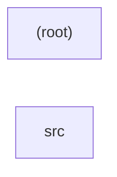

# repository — kết quả phân tích (bản sinh tự động)

- Snapshot: `snap:cfd2c61676ad1172404183ea995d9d3fa42d51454c0181ff585e4262764c6a48`
- Schema 0.1.0; renderer slice-render-v2; template slice-template-v1
- Phạm vi: 10 file trong 1 unit; 1 file bị loại khỏi snapshot

## Sơ đồ component

## Mục lục contract

- api: [tech-specs/SRC/api/API-REPOSITORY-SRC-v1.md](tech-specs/SRC/api/API-REPOSITORY-SRC-v1.md) — component `cmp_fb03cc18340268abdbf9d389e8b1706d58add53a1ef8197715f354109c4107db`
- table: [tech-specs/SRC/schema/TBL-REPOSITORY-SRC.md](tech-specs/SRC/schema/TBL-REPOSITORY-SRC.md) — component `cmp_fb03cc18340268abdbf9d389e8b1706d58add53a1ef8197715f354109c4107db`

## Mục lục EVT theo topic

- (không có)

## Contract chưa gán được component

- (không có)

## Giới hạn

- `SLICE_SCOPE` (inventory): Lát cắt đầu chỉ nhận route FastAPI và bảng SQLAlchemy Column
- `MODEL_NOT_RUN` (model): Không gọi provider; tên component lấy từ membership

## Giới hạn biểu diễn

- `DDL_BLOCK_OMITTED`: Không bảng nào đủ dữ kiện cho DDL — `fact:2caecd4e474751b99e150c21b3399e494202a21dfde54479f3f6e483ff54ff42`, `fact:5a2f1f2c9de4885438f6253beb2c57247ca2e9f4478ef3d28bb1bb2f15857145`, `fact:a2a7e2af618a58ef70390cef462dbaa863b293373f1c812c51c04f715e559f7e`, `fact:cb9aea99783f5cf35455b6ef7c358e2e48d4d15b01090f1b0f8adbcf0cfef915`, `fact:fe1a13c50954402346a211d189c493886345915a252b10c52d6941c5c1fe3d10`
- `DDL_TABLE_OMITTED`: dialect chưa biết — `fact:2caecd4e474751b99e150c21b3399e494202a21dfde54479f3f6e483ff54ff42`
- `DDL_TABLE_OMITTED`: dialect chưa biết — `fact:5a2f1f2c9de4885438f6253beb2c57247ca2e9f4478ef3d28bb1bb2f15857145`
- `DDL_TABLE_OMITTED`: name chưa biết — `fact:a2a7e2af618a58ef70390cef462dbaa863b293373f1c812c51c04f715e559f7e`
- `DDL_TABLE_OMITTED`: name chưa biết — `fact:cb9aea99783f5cf35455b6ef7c358e2e48d4d15b01090f1b0f8adbcf0cfef915`
- `DDL_TABLE_OMITTED`: name chưa biết — `fact:fe1a13c50954402346a211d189c493886345915a252b10c52d6941c5c1fe3d10`
- `OPENAPI_BLOCK_OMITTED`: Không route nào đủ method, path đầy đủ và status code — `fact:2cb737c7c6bc66c86fd735a49fd49f7310ae42223680e4d210328d816dcc33d9`, `fact:3281c2950a7cea18ba431239295dbff04ad9c34e7d5d81073c10d7030e08bead`, `fact:3681f4001080cabaee527f80100109b04bc71a42f89422a32a8d8b24ed73e977`, `fact:5af35f7c36f88c40630ba11e3ea13ec43c853a3fd03cf51196b96fd97a4f3c8e`, `fact:5bb067e4defd75c506557f74dfc7e2e3a91f92f2d26ad4e2a3dab4e0b2d3cded`, `fact:6b9c041f08f5ab453201135ac1c2990398f39b835779db967db1cf9cc8610554`, `fact:6bdeaa30b28b5651d71349db5f10be31d345c34cbbd70ea44f16782aae1cf6c4`, `fact:72a8cfaafb2a53aa9c92cea20475cec4c668636a222b6f7283efa9a7be9a068e`, `fact:7a55162029aa9772ba602297981a1bef1d5e9c4ab152ed7dcea56da8c11ab52d`, `fact:7c19a86e1153ca93202b97d008f8ece7ea9f70b8177f693b9eac9cc85f9c93dc`, `fact:83cc98e9437062ea063344c32b4f902a0c7a678ba3d98583ac003d73e71c6b4e`, `fact:84b1cade87d7e44aa4ba632671847ced5b63b3598d2f89484fadc5034311edf1`, `fact:8acbbf720204b4b64373237e0d90d95eea40515c50d5e9d454f41fc442091ce5`, `fact:9b658d9eb1f2ff3ed18b9a7d6b02f7e66a9f120baf4823d5294c510057229271`, `fact:a27d9cdc58107bcb84c9d4a0390536d9db0877f0cf13e9fb97bea2b111ab8d3e`, `fact:b981737a73895a6f80fac9ecbbdeffdadec80d83b804e6768f804dc2cfb59cf1`, `fact:df84a5ef862f9aa381a3afbbda8d7ee387a4de2534c08414e1842b3ec29bae51`, `fact:f02fd81e5edb7a87fc61a268990aabe537c1492bafe14f3cd9e41279c10e82eb`, `fact:fe8b7b6b86240365d443dea67a2d672b20a973fdd1793da229c741a2361a5274`
- `OPENAPI_OPERATION_OMITTED`: Status code chưa biết — `fact:2cb737c7c6bc66c86fd735a49fd49f7310ae42223680e4d210328d816dcc33d9`
- `OPENAPI_OPERATION_OMITTED`: Path có tham số nhưng tham số chưa được trích đủ — `fact:3281c2950a7cea18ba431239295dbff04ad9c34e7d5d81073c10d7030e08bead`
- `OPENAPI_OPERATION_OMITTED`: Status code chưa biết — `fact:3681f4001080cabaee527f80100109b04bc71a42f89422a32a8d8b24ed73e977`
- `OPENAPI_OPERATION_OMITTED`: Path có tham số nhưng tham số chưa được trích đủ — `fact:5af35f7c36f88c40630ba11e3ea13ec43c853a3fd03cf51196b96fd97a4f3c8e`
- `OPENAPI_OPERATION_OMITTED`: Status code chưa biết — `fact:5bb067e4defd75c506557f74dfc7e2e3a91f92f2d26ad4e2a3dab4e0b2d3cded`
- `OPENAPI_OPERATION_OMITTED`: Status code chưa biết — `fact:6b9c041f08f5ab453201135ac1c2990398f39b835779db967db1cf9cc8610554`
- `OPENAPI_OPERATION_OMITTED`: Status code chưa biết — `fact:6bdeaa30b28b5651d71349db5f10be31d345c34cbbd70ea44f16782aae1cf6c4`
- `OPENAPI_OPERATION_OMITTED`: Status code chưa biết — `fact:72a8cfaafb2a53aa9c92cea20475cec4c668636a222b6f7283efa9a7be9a068e`
- `OPENAPI_OPERATION_OMITTED`: Status code chưa biết — `fact:7a55162029aa9772ba602297981a1bef1d5e9c4ab152ed7dcea56da8c11ab52d`
- `OPENAPI_OPERATION_OMITTED`: Status code chưa biết — `fact:7c19a86e1153ca93202b97d008f8ece7ea9f70b8177f693b9eac9cc85f9c93dc`
- `OPENAPI_OPERATION_OMITTED`: Path có tham số nhưng tham số chưa được trích đủ — `fact:83cc98e9437062ea063344c32b4f902a0c7a678ba3d98583ac003d73e71c6b4e`
- `OPENAPI_OPERATION_OMITTED`: Path có tham số nhưng tham số chưa được trích đủ — `fact:84b1cade87d7e44aa4ba632671847ced5b63b3598d2f89484fadc5034311edf1`
- `OPENAPI_OPERATION_OMITTED`: Path có tham số nhưng tham số chưa được trích đủ — `fact:8acbbf720204b4b64373237e0d90d95eea40515c50d5e9d454f41fc442091ce5`
- `OPENAPI_OPERATION_OMITTED`: Status code chưa biết — `fact:9b658d9eb1f2ff3ed18b9a7d6b02f7e66a9f120baf4823d5294c510057229271`
- `OPENAPI_OPERATION_OMITTED`: Path có tham số nhưng tham số chưa được trích đủ — `fact:a27d9cdc58107bcb84c9d4a0390536d9db0877f0cf13e9fb97bea2b111ab8d3e`
- `OPENAPI_OPERATION_OMITTED`: Path có tham số nhưng tham số chưa được trích đủ — `fact:b981737a73895a6f80fac9ecbbdeffdadec80d83b804e6768f804dc2cfb59cf1`
- `OPENAPI_OPERATION_OMITTED`: Status code chưa biết — `fact:df84a5ef862f9aa381a3afbbda8d7ee387a4de2534c08414e1842b3ec29bae51`
- `OPENAPI_OPERATION_OMITTED`: Path có tham số nhưng tham số chưa được trích đủ — `fact:f02fd81e5edb7a87fc61a268990aabe537c1492bafe14f3cd9e41279c10e82eb`
- `OPENAPI_OPERATION_OMITTED`: Path có tham số nhưng tham số chưa được trích đủ — `fact:fe8b7b6b86240365d443dea67a2d672b20a973fdd1793da229c741a2361a5274`
