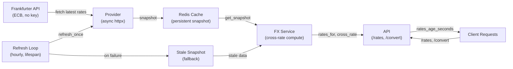

# Architecture

## System Layers

## Request Flow

1. **Client requests** `/rates` or `/convert`
2. **Service checks cache** → returns snapshot (always served from cache, never blocking on upstream)
3. **Background refresh loop** (independent of requests):
   - Every hour, `refresh_once()` calls provider for new rates
   - On success → updates Redis snapshot
   - On failure → retains previous snapshot (stale fallback)
   - Loop continues even if provider is down

## Resilience

**Stale fallback** ensures requests never fail due to temporary provider outages:
- Cache holds a persistent snapshot with `fetched_at` timestamp
- `rates_age_seconds` returned in every response lets clients know age
- If upstream is unreachable during refresh, clients still get a (potentially stale) answer
- No request timeout or circuit-breaker logic needed — cache + loop handle graceful degradation

## Conversions

- **Cross-rate:** derive rate between any two currencies via the base (EUR)
- **Integer-minor-unit:** amount is in cents/satoshis; uses Decimal ROUND_HALF_UP for accuracy
- All rates cached; no per-request provider calls
